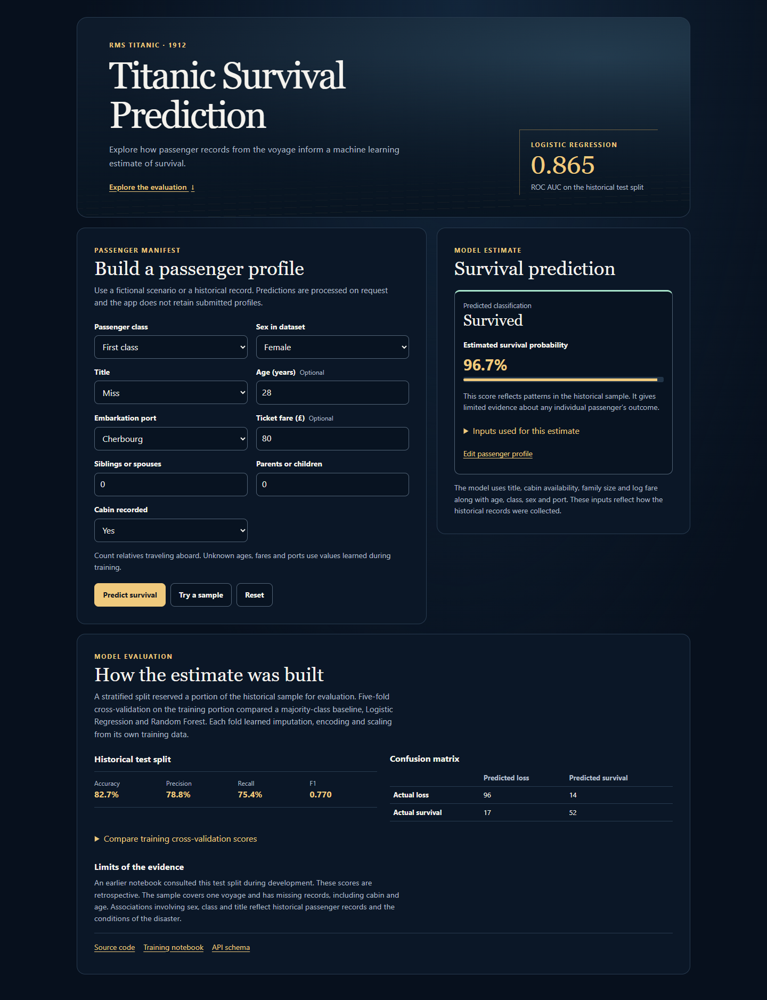
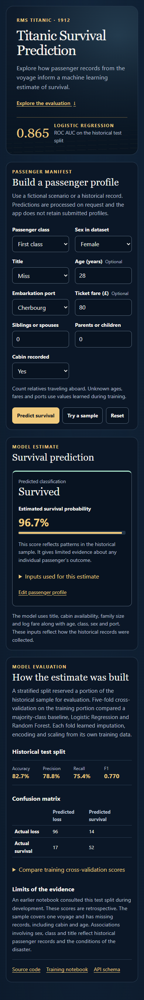

# Titanic Survival Prediction

An end-to-end ML engineering project for estimating Titanic survival from historical passenger attributes. It includes a reproducible scikit-learn experiment, a stateless FastAPI inference API, and a browser demo for exploring fictional scenarios.

[Live demo](https://titanic-survival-prediction-nine.vercel.app)

[Experiment notebook](notebook/Titanic.ipynb) · [Evaluation artifacts](model/metrics.json) · [Audit notes](docs/audit.md)

## What the model learned

The task is binary classification on 891 labeled Titanic passenger records. A stratified 80/20 split with seed 42 yielded 712 development records and 179 holdout records. Five shuffled stratified folds on the development partition compared a majority-class baseline, logistic regression, and a depth-limited random forest. Each fold fits its own imputation, scaling, and encoding.

| Development model | Accuracy | Survival F1 | ROC AUC |
| --- | ---: | ---: | ---: |
| Majority-class baseline | 0.6166 | 0.0000 | 0.5000 |
| Logistic regression | 0.8244 | 0.7683 | 0.8747 |
| Random forest | 0.8301 | 0.7649 | 0.8735 |

**Logistic regression** had the highest mean development ROC AUC under the selection rule. The 0.0011 difference from random forest is small relative to the fold variability. Logistic regression also keeps the fitted artifact compact and the model straightforward to explain.

### Retrospective holdout results

| Accuracy | Survival precision | Survival recall | Survival F1 | ROC AUC |
| ---: | ---: | ---: | ---: | ---: |
| 0.8268 | 0.7879 | 0.7536 | 0.7704 | 0.8653 |

| Actual ↓ / Predicted → | Did not survive | Survived |
| --- | ---: | ---: |
| Did not survive | 96 | 14 |
| Survived | 17 | 52 |

The model missed 17 of the 24 male survivors in the holdout and predicted survival for 11 of the 16 female non-survivors. These counts describe this split and include small subgroups. The notebook and metrics file provide the aggregate breakdown by class, recorded sex, and age availability.

The original project had already inspected this split through exploratory analysis and baseline scoring. The revised protocol keeps all model comparisons in development, then repeats the historical evaluation on the same holdout. Of its 179 rows, 67 share a ticket with a development row. Related passengers and the use of a single event limit how far these results generalize. The probability is an uncalibrated model estimate for the entered profile. It carries biases from the event and record collection, including differences by passenger class, recorded sex, and cabin documentation.

### Features and preprocessing

The shared transformer uses passenger class, recorded sex, age, embarkation port, normalized title, and whether a cabin was listed. It derives family size and traveling-alone status from the family counts and transforms fare with `log1p`. Traveling-alone status is a threshold derived from family size. Passenger IDs and ticket identifiers are excluded from modeling. Numerical values are median-imputed and scaled. Categories use most-frequent imputation and one-hot encoding with unknown categories ignored. The public form supplies title and cabin availability directly, so it never asks for a name or cabin number.

## Run locally

Requires Python 3.12.

```bash
python -m venv .venv
# Activate .venv using your shell, then:
python -m pip install -r requirements.txt
python -m uvicorn app.main:app --no-access-log
```

Open `http://127.0.0.1:8000`. The app loads the bundled pipeline, so prediction works without the training CSV.

### Reproduce training and execute the notebook

Download **Titanic Dataset**, version 1, from Kaggle and place `Titanic-Dataset.csv` in `data/`. The dataset listing declares CC0. The download used for verification matches the SHA-256 recorded in the evaluation manifest. The current tree and deployment omit the raw passenger records. [Dataset listing](https://www.kaggle.com/datasets/yasserh/titanic-dataset)

```bash
python -m pip install -r requirements-dev.txt
python train.py --data data/Titanic-Dataset.csv --output-dir model
python -m nbconvert --to notebook --execute notebook/Titanic.ipynb --output Titanic.executed.ipynb
```

The trainer chooses the model, scores the fitted winner, and writes the pipeline and its metrics together. The notebook uses the same experiment code and displays aggregate results. The manifest records the seed, versions, source checksum, and model checksum. The checked-in digest identifies the deployed binary. Reproducing numerical results across platforms does not require identical serialized bytes.

Run one trainer per output directory. For release candidates, use a fresh output directory and validate the generated pair before copying it into the deployment. If an export is interrupted, rerun it to regenerate both files.

## API

`POST /api/predict` accepts JSON with the following shape.

```json
{
  "Pclass": 3,
  "Sex": "male",
  "Age": 23,
  "SibSp": 1,
  "Parch": 0,
  "Fare": 12.5,
  "Embarked": "S",
  "Title": "Mr",
  "HasCabin": false
}
```

The response includes `prediction`, `prediction_code` (0 or 1), `survival_probability` (0–1), and `survival_percentage` (rounded for display). All fields are required. Age, fare, and port accept `null` when unknown. The [schema](http://127.0.0.1:8000/openapi.json) includes bounds and category values. Invalid fields return 422, oversized bodies return 413, and unavailable inference returns 503. `GET /health` returns the verified model checksum when the app is ready.

## Architecture and deployment

```text
HTML and vanilla JS → same-origin FastAPI → validated passenger data
                                         → shared preprocessing pipeline
                                         → fitted logistic regression
```

Inference has no data store or session history. The server verifies the bundled model digest and ML dependency versions before deserializing it. The deployment uses the Vercel FastAPI integration with Python 3.12 and pinned runtime dependencies. Notebook libraries, raw data, tests, and local databases are excluded by `.vercelignore`. [Vercel FastAPI documentation](https://vercel.com/docs/frameworks/backend/fastapi)

### Checks

```bash
python -m pip install -r requirements-dev.txt
python -m playwright install chromium
python -m ruff check .
node --check app/static/script.js
python -m pytest -q
```

CI runs on pull requests and main. It covers feature behavior, inference parity, request validation, privacy regressions, and Chromium interactions. With the verified CSV present locally, the suite also reruns the training experiment.

## Screenshots




